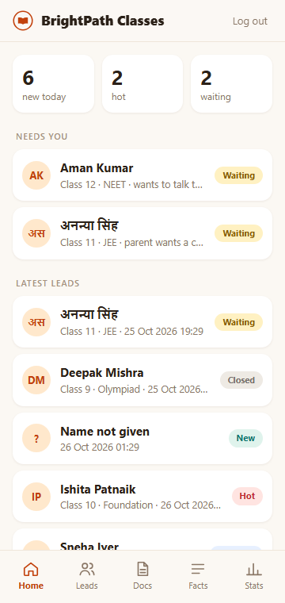
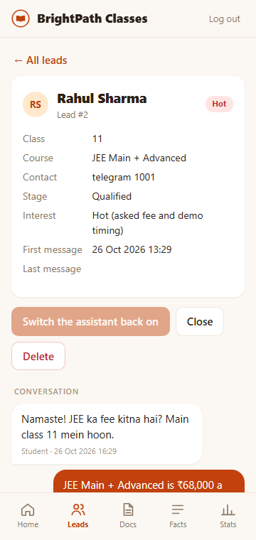
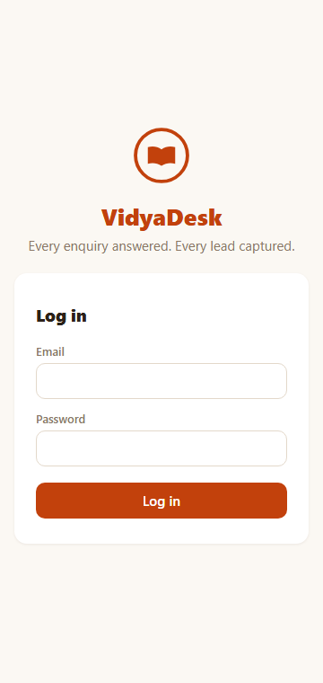
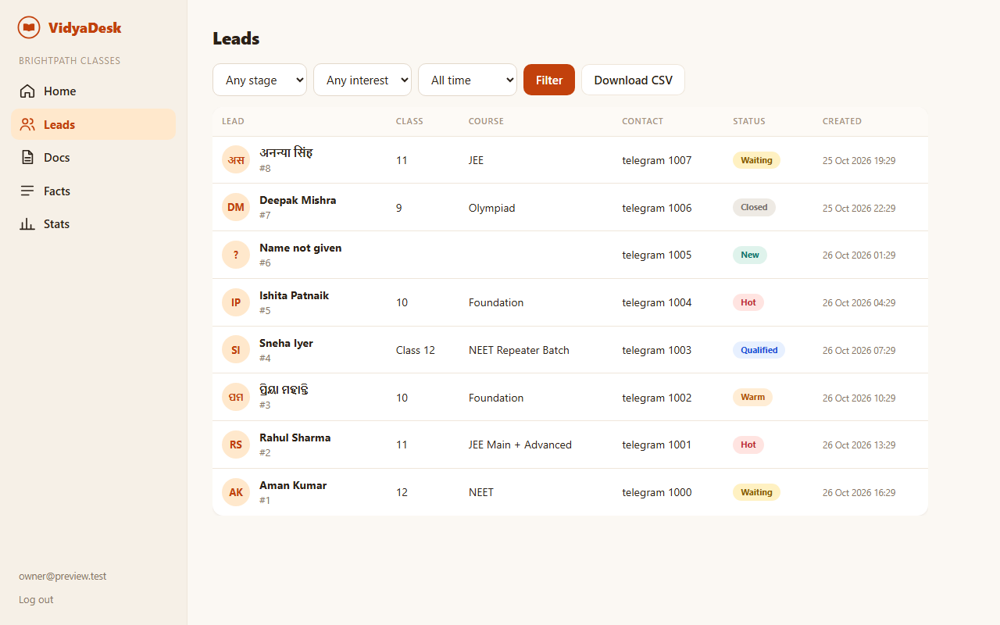
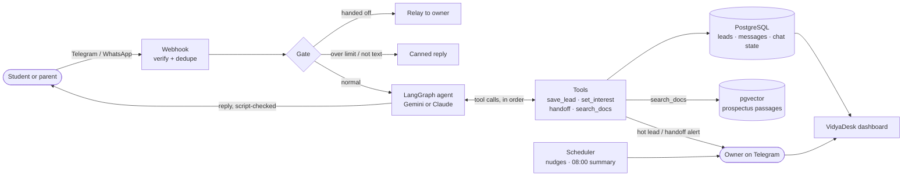

# VidyaDesk

**An AI enquiry assistant for coaching institutes.** It answers students and parents on Telegram (WhatsApp ready)
at any hour, in English, Hindi, Hinglish or Odia, turns every chat into a lead, and gives the owner a phone-first
dashboard of who needs a call.

  
  
  

*Screenshots use made-up sample leads.*

## The problem

A local coaching institute gets most enquiries in the evening, by message, while the owner is teaching. Questions
about fees and batches go unanswered for hours, and a student who doesn't get an answer asks the next institute.

## What it does

- **Answers instantly** about fees, batches and timings from the institute's own facts (exact numbers, never
  invented), and from its prospectus PDF when the facts don't cover the question.
- **Replies in the user's language and script**: English, Hindi, Hinglish, Odia, or Odia written in English letters.
- **Captures the lead**: name, class, course and phone, and rates interest as hot, warm or cold with a reason.
- **Hands off to a human** when asked, when the user is upset, or when nothing answers the question, and tells the
  owner at once. While a person handles it, the student's new messages are forwarded to the owner.
- **Follows up**: one polite nudge to a lead that went quiet (daytime only), and an 08:00 summary for the owner.
- **Owner dashboard (VidyaDesk)**: today's numbers, "needs you", every conversation, CSV export, documents, facts
  editor and stats. Several institutes run on one deployment, each seeing only its own data.

## How it works

Each message is stored first, then passes a **gate** (message limit, handed-off leads, stickers) before the model
is called. The agent reads the last 20 messages and the institute's facts, calls tools one at a time, and its reply
is rewritten once if it came out in a different script from the user's message.

## Engineering highlights

- **LangGraph agent with durable memory.** A `StateGraph` (gate → relay / canned / agent ⇄ tools) with a PostgreSQL
  checkpointer. LangGraph's stock `ToolNode` runs tool calls in parallel threads, which raced (a save and a handoff
  in one turn lost data), so the graph has its own sequential tool node.
- **Facts for numbers, RAG for documents.** Fees and batches come from structured, validated facts so they are
  quoted exactly; long documents go through retrieval. Retrieval uses a local embedding model
  (`BAAI/bge-small-en-v1.5` via fastembed, 384 dimensions) and pgvector cosine search over ~100-word passages,
  with a similarity floor chosen from measurements.
- **Measured, not assumed.** A behaviour-check harness runs 26 scripted conversations against the real model
  (languages, handoffs, manipulation attempts, document questions) and checks automatically that every ₹ amount in a
  reply exists in the facts or a retrieved passage. A retrieval benchmark checks the expected passage is in the top 3.
- **Multi-tenant and secure by default.** Every query is scoped to the logged-in owner's institute, and another
  institute's page answers 404, the same as a missing one, so slugs cannot be probed. Bot tokens are
  Fernet-encrypted at rest, passwords are bcrypt-hashed, and logins lock after 5 failures in 15 minutes. Cookies are
  HTTPS-only and SameSite=Strict, CSV exports neutralise spreadsheet formulas, and upload names are sanitised (a
  Windows drive-relative name such as `Y:.env` was caught in review and is refused). Telegram's secret header and
  WhatsApp's HMAC signature are verified on every webhook.
- **Reliability details.** A per-lead lock serialises replies and deletes, resent webhooks are dropped with
  `INSERT … ON CONFLICT DO NOTHING RETURNING`, and there is a 24-hour message cap per lead. Nudges re-check their
  rules under the lock right before sending.
- **Tested.** 316 automated tests (graph with a scripted model, tenant isolation, escaping, CSV, uploads, login
  throttle) run in CI against PostgreSQL with pgvector.

## Results

| What | Result | Notes |
|---|---|---|
| Behaviour checks on Gemini 3.5 Flash-Lite | **26 of 26** | One run, 16 Oct 2026; model answers vary between runs |
| Retrieval: expected passage in top 3 | **21 of 21** on the `.txt` prospectus, **21 of 21** on a PDF copy | 16 Oct 2026 |
| Automated tests | **316 passed** | CI on every push |
| Live demo | Telegram bot, owner alerts, follow-up and morning summary verified end to end | 14–15 Oct 2026 |

## Tech stack

Python · FastAPI · LangGraph · LangChain (Gemini / Claude) · PostgreSQL + pgvector · SQLAlchemy · fastembed ·
APScheduler · Jinja2 · Telegram Bot API · WhatsApp Cloud API · pytest · GitHub Actions

## Status and roadmap

- **Built:** core agent (M1), document search (M2), owner dashboard (M3), and the VidyaDesk redesign.
- **Waiting:**
  - WhatsApp: Meta flagged the free test number. The webhook, signature and token flow all work, and a real
    business number is next.
  - Behaviour checks on Claude: waiting for API credits.
  - Odia wording: needs a native speaker's read.
- **Next:** voice notes (Odia and Hindi speech to text), a server with a fixed address, and the refinement backlog in
  [the design spec, Section 15](docs/specs/2026-10-13-lead-agent-design.md).

## Set up

1. Install PostgreSQL and create the `leadagent` and `leadagent_test` databases.
2. `python -m venv .venv` then `.\.venv\Scripts\python -m pip install -e ".[dev]"`
3. Copy `.env.example` to `.env` and fill it in.
   `LLM_PROVIDER=gemini` uses Google's free tier (test data only, never real students); `anthropic` uses Claude.
4. `.\.venv\Scripts\python -m pytest -q`

## Run

`.\.venv\Scripts\python -m uvicorn leadagent.app:app --port 8000`

Run exactly one process: no `--reload` and no `--workers`. The scheduler and the per-lead lock assume it.
[docs/DEMO_CHECKLIST.md](docs/DEMO_CHECKLIST.md) has the steps for adding institutes and connecting Telegram and WhatsApp.

## Documents (RAG)

Each institute can add its prospectus, brochures or rules. The agent searches them when its structured facts
do not answer a question.

    .\.venv\Scripts\python -m leadagent.rag.ingest --institute brightpath examples/brightpath-prospectus.txt
    .\.venv\Scripts\python -m leadagent.rag.ingest --institute brightpath --list
    .\.venv\Scripts\python -m leadagent.rag.ingest --institute brightpath --delete <id>

PDF, `.txt` and `.md`, up to 10 MB. Adding a file with the same name replaces the old version. Scanned PDFs
are refused (no OCR yet). The embedding model runs locally and downloads once (about 70 MB) into `data/models/`.
PostgreSQL needs the pgvector extension. Retrieval quality: `python -m evals.retrieval` (needs the dev extras: `pip install -e ".[dev]"`, it uses fpdf2).
Real-model tests: set `RUN_MODEL_TESTS=1` before `pytest`.

## Dashboard

Owners and the admin log in at `<PUBLIC_BASE_URL>/dash` (locally, `http://127.0.0.1:8000/dash` works only with
`SESSION_HTTPS_ONLY=false` in `.env`, because the login cookie is HTTPS-only by default).

    .\.venv\Scripts\python -m leadagent.cli add-user --email you@example.com --role admin
    .\.venv\Scripts\python -m leadagent.cli add-user --email owner@example.com --role owner --slug brightpath
    .\.venv\Scripts\python -m leadagent.cli set-password --email owner@example.com

The dashboard is branded **VidyaDesk** (warm cream-and-saffron look, bottom tabs on a phone, a sidebar on a laptop).
An owner sees only their institute: a Home screen (today's numbers, the leads waiting for them, the newest leads),
leads with filters and CSV export, each lead's conversation as chat bubbles with resume / close / delete, documents,
the facts editor and stats. The admin also manages institutes. The first visit on each browser plays a short welcome
animation (skippable, never for "reduce motion" users); after that the dashboard opens straight to Home.
`SESSION_SECRET` in `.env` signs the login cookie; without it, everyone is logged out on every restart.

## Layout

| Path | Contents |
|---|---|
| `leadagent/channels/` | Telegram and WhatsApp: verify, parse, send |
| `leadagent/agent/` | The LangGraph graph, its tools and prompts |
| `leadagent/store/` | Database models and queries |
| `leadagent/jobs/` | Follow-up and daily summary jobs |
| `leadagent/rag/` | Documents: reading, splitting into passages, embedding, search |
| `leadagent/dashboard/` | Web dashboard: routes and templates |
| `leadagent/pipeline.py` | One incoming message from start to finish |
| `leadagent/cli.py` | Add and configure institutes |
| `evals/` | Behaviour checks against a real model: `python -m evals.run` |
| `docs/specs/` | Design spec. Section 15 is the refinement backlog. |
| `docs/plans/` | Build plans, one per milestone |

## License

MIT, see [LICENSE](LICENSE).
